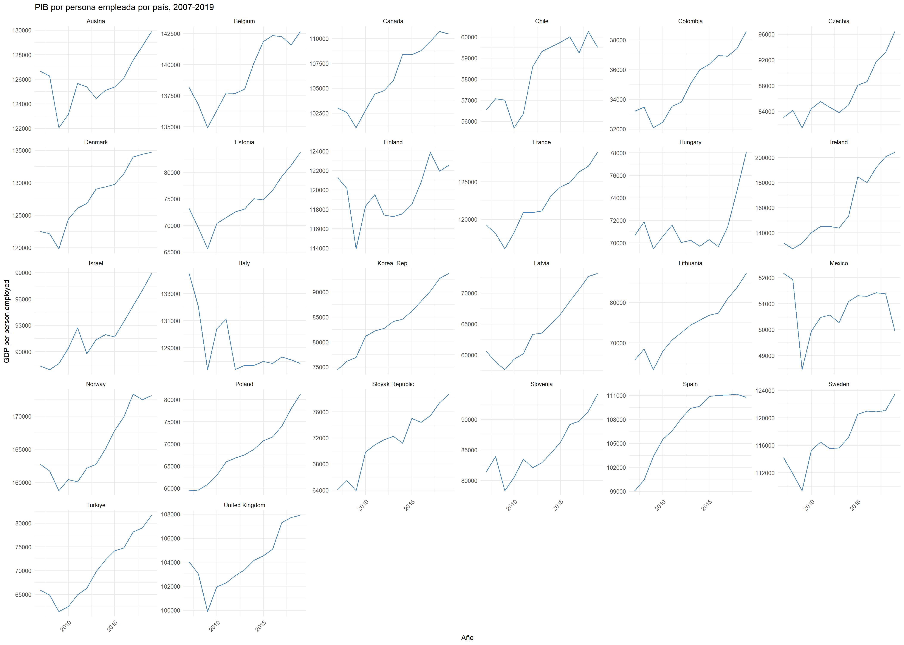
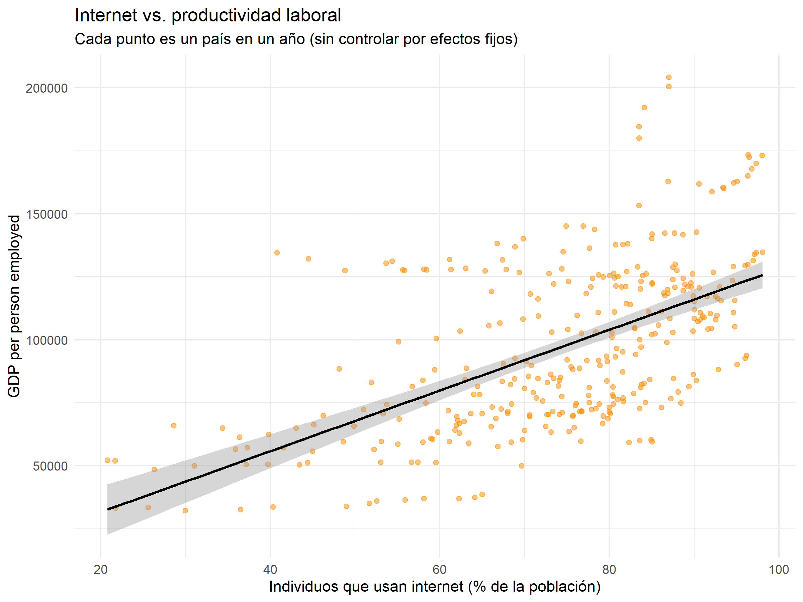

# Taller de Modelos de Panel: Efectos Fijos vs. Efectos Aleatorios

## Tecnología y Productividad Laboral en Países de la OCDE

---

## 1. Pregunta de investigación

¿La penetración de internet y el acceso a tecnología explican mejor la productividad laboral que la inversión física e institucional tradicional, en un panel de países de la OCDE?

Formulación específica: ¿en qué medida el acceso a internet, la electrificación, la inversión en capital humano (educación terciaria) y el gasto en I+D se asocian con la productividad laboral (PIB por persona empleada), y cómo cambian estas estimaciones al controlar por heterogeneidad no observada entre países (efectos fijos) frente a asumir que esa heterogeneidad es aleatoria (efectos aleatorios)?

---

## 2. Datos

**Fuente:** World Development Indicators (WDI), World Bank Data Bank

**Estructura del panel:** balanceado, 26 países de la OCDE × 13 años (2007-2019) = 338 observaciones

| Rol | Variable | Código WDI |
|---|---|---|
| Dependiente | PIB por persona empleada (constante, PPP) | `SL.GDP.PCAP.EM.KD` |
| Regresor | Individuos que usan internet (% de la población) | `IT.NET.USER.ZS` |
| Regresor | Acceso a electricidad (% de la población) | `EG.ELC.ACCS.ZS` |
| Regresor | Matrícula en educación terciaria (% bruto) | `SE.TER.ENRR` |
| Regresor | Gasto en I+D (% del PIB) | `GB.XPD.RSDV.GD.ZS` |

**Nota metodológica:** se excluyeron 12 países* de la OCDE por datos faltantes en matrícula terciaria y/o gasto en I+D, priorizando mantener el panel balanceado.

*Australia, Costa Rica, Luxemburgo, Japón, Islandia, Grecia, Alemania, Estados Unidos, Suiza, Portugal, Nueva Zelanda, Países Bajos.

---

## 3. Estadística descriptiva

### Variación entre países vs. dentro de cada país (PIB por trabajador)

| Fuente de variación | Desviación estándar |
|---|---|
| Entre países | 33,377 |
| Dentro de cada país (en el tiempo) | 6,670 |

La variación entre países es ~5 veces mayor que la variación dentro de cada país. La mayor parte de las diferencias en productividad se explica por diferencias estructurales entre países (más que por cambios año a año dentro de un mismo país), lo cual anticipa que el estimador de efectos fijos —que usa solo la variación "dentro"— trabajará con relativamente menos información que el de efectos aleatorios.

---

## 4. Resultados de los modelos

### 4.1 Comparación de modelos

| Modelo | Descripción |
|---|---|
| Pooled OLS | Ignora la estructura de panel; trata cada observación país-año como independiente |
| Efectos Fijos (FE) | Controla por heterogeneidad constante en el tiempo dentro de cada país |
| Efectos Aleatorios (RE) | Asume que el efecto país no está correlacionado con los regresores |

### Comparación de modelos: PIB por trabajador

| Variable | Pooled OLS (1) | Efectos Fijos (2) | Efectos Aleatorios (3) |
|---|---:|---:|---:|
| Internet | 806.79*** (125.61) | 435.61*** (51.69) | 427.96*** (52.06) |
| Electricidad | 11,023.92*** (3,140.52) | -5,911.07*** (1,446.69) | -5,394.33*** (1,456.37) |
| Matrícula terciaria | -118.16 (107.90) | 102.14** (49.87) | 102.53** (50.28) |
| Gasto en I+D | 6,238.88*** (1,591.68) | -2,066.07 (1,433.14) | -1,057.16 (1,403.00) |
| Constante | -1,066,337.00*** (308,445.60) | — | 598,224.00*** (144,024.00) |
| **Observaciones** | 338 | 338 | 338 |
| **R²** | 0.395 | 0.300 | 0.284 |
| **R² ajustado** | 0.388 | 0.235 | 0.275 |

*Errores estándar entre paréntesis. Significancia: \*p<0.1; \*\*p<0.05; \*\*\*p<0.01*

### 4.2 Test de Hausman: FE vs. RE

- **H0:** los efectos individuales (país) no están correlacionados con los regresores → RE es válido y más eficiente
- **Resultado:** p = 0.0312

Como p < 0.05, se **rechaza H0**. El supuesto necesario para que RE sea válido no se sostiene con estos datos: los efectos específicos de cada país sí están correlacionados con las variables explicativas. **Se selecciona el modelo de Efectos Fijos (FE)** como el especificación correcta.

---

## 5. Diagnósticos y robustez

| Test | Qué evalúa | p-valor | Conclusión |
|---|---|---|---|
| Breusch-Pagan | Heterocedasticidad | 0.0025 | Se rechaza homocedasticidad → usar errores robustos |
| Wooldridge (panel) | Autocorrelación serial | ≈ 0 | Se rechaza no-autocorrelación → usar errores robustos |

Ambos diagnósticos confirman la necesidad de reportar errores estándar robustos, agrupados (*clustered*) por país (método Arellano). **Importante:** estas correcciones no cambian la magnitud de los coeficientes estimados, solo corrigen la precisión con la que se calculan sus errores estándar.

---

## 6. Resultados finales: modelo de Efectos Fijos con errores robustos

| Variable | Coeficiente | Error estándar (robusto) | t | p-valor | Significancia |
|---|---:|---:|---:|---:|:---:|
| Internet (% población) | 435.61 | 166.21 | 2.62 | 0.0092 | ** |
| Electricidad (% población) | -5911.07 | 3111.83 | -1.90 | 0.0584 | . |
| Matrícula terciaria (% bruto) | 102.14 | 94.42 | 1.08 | 0.2802 | — |
| Gasto en I+D (% PIB) | -2066.07 | 4795.03 | -0.43 | 0.6669 | — |

*Códigos de significancia: \*\*\* p<0.001, \*\* p<0.01, \* p<0.05, . p<0.10*

### Interpretación por variable

**Internet — significativo al 1%.** Por cada punto porcentual adicional de población con acceso a internet, el PIB por trabajador aumenta en promedio 435.6 unidades (PPP constante), controlando por heterogeneidad no observada entre países. Es la única variable con evidencia robusta y consistente con la hipótesis del taller.

**Electricidad — significativo solo al 10%, signo negativo.** Resultado a interpretar con cautela: en países de la OCDE el acceso a electricidad está cerca del 100% desde el inicio del panel, por lo que hay muy poca variación *dentro* de cada país en el tiempo — precisamente la única fuente de variación que usa el estimador FE. Con tan poco movimiento en la variable, el coeficiente es inestable y no debe interpretarse como un efecto causal creíble.

**Matrícula terciaria — no significativa.** No hay evidencia, dentro de este panel, de que los cambios en matrícula terciaria dentro de un país se asocien con cambios en su productividad laboral.

**Gasto en I+D — no significativo.** Posibles explicaciones: efecto rezagado no capturado por el modelo (la inversión en I+D puede tardar varios años en reflejarse en productividad), y/o baja variación temporal dentro de cada país durante el período.

---

## 7. Conclusión

La evidencia del panel de 26 países de la OCDE (2007-2019) respalda parcialmente la hipótesis de que el acceso a tecnología explica la productividad laboral: **el internet es el único regresor con un efecto positivo, robusto y estadísticamente significativo**, incluso después de controlar por heterogeneidad no observada entre países y de corregir por heterocedasticidad y autocorrelación serial. Las variables de infraestructura tradicional y capital humano/I+D consideradas en este modelo no muestran una asociación robusta con la productividad en este panel específico — un resultado válido en sí mismo, que distingue el rol de cada tipo de insumo más que confirmar una hipótesis uniforme sobre "tecnología en general".

### Limitaciones a discutir

- Poca variación temporal en electricidad dentro de países OCDE limita la interpretación de ese coeficiente
- El efecto del gasto en I+D sobre productividad probablemente opera con rezago, no capturado en esta especificación estática
- El panel excluye 12 países de la OCDE por datos faltantes, lo que podría introducir algún sesgo de selección hacia países con mejor infraestructura estadística

---

## 8. Metodología completa (resumen técnico)

1. **Limpieza y reshape** de datos del World Bank Data Bank (ancho → largo), eliminando filas de metadatos
2. **Declaración del panel** (`pdata.frame`, índice país-año)
3. **Estadística descriptiva** y análisis de variación entre/dentro de países
4. **Estimación** de Pooled OLS, Efectos Fijos y Efectos Aleatorios (paquete `plm` en R)
5. **Test de Hausman** para seleccionar la especificación correcta
6. **Diagnósticos** de heterocedasticidad (Breusch-Pagan) y autocorrelación (Wooldridge)
7. **Reporte final** con errores estándar robustos agrupados por país (método Arellano)